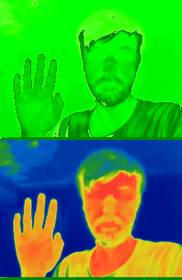
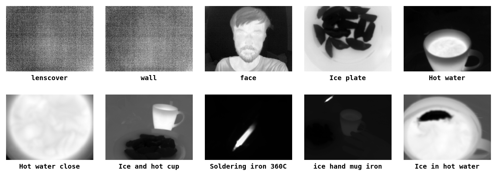
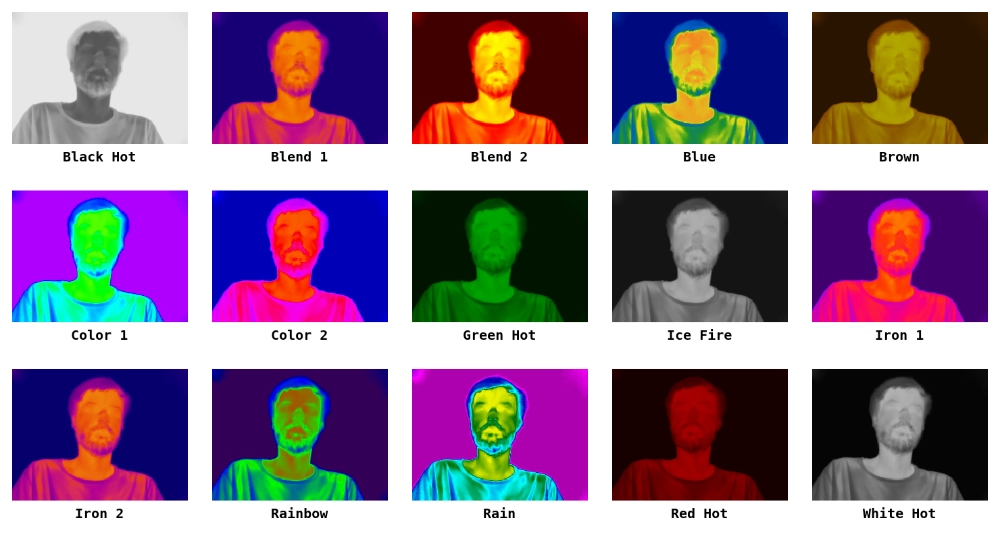

# Thermal Camera Notes

I got a cheap (AUD$180) thermal camera Hti `HT-203U` from Aliexpress during Black Friday sales. The only supported software is the Android app "Smart Thermal" which rather limited/poor. This repo is for notes/tools made during experimentation with the goal of some usable camera tooling running on my Linux machines for electronics inspection and documentation use.

This README is a high-level summary, more detailed notes are in `/docs`. 
This [EEVBlog thread](https://www.eevblog.com/forum/thermal-imaging/hti-ht-203u-256x192-thermal-imager-for-android-phones/) has some discussion about different apps and mounting ZnSe lenses for macro use.

# Viewing the camera feed from Linux

Connected the camera to my machine with a USBC extension cable, and sometimes a adapter (USB-C socket to USB-A plug). It enumerates as a USB2 device `2bdf:0102 HIK HikCamera`.

It's viewable by default as a UVC camera but required a modified uvc 'quirk' to operate.
Modify `/etc/modprobe.d/uvcvideo.conf` with the quirk:

```
options uvcvideo quirks=0x02
```

Reboot or reload as desired. Check it is set with `cat /sys/module/uvcvideo/parameters/quirks`

## View & Record the UVC endpoint

Because it's a usable UVC device, simple incantations using `mpv` and `ffmpeg` provide quick preview/capture tooling. I couldn't get the camera to work with browsers or typical webcam tools like this though.

- The system requires `ffmpeg` and `v4l2`.
- Realtime view: `mpv av://v4l2:/dev/video0 --profile=low-latency --untimed`
- Record to file: `sudo ffmpeg -input_format yuyv422 -video_size 256x128 -i /dev/video0 test6.mkv`

> Use 256x392 for the dual output image (green ratiometric + shaded thermal view)



The top-half of the image is the `YUYV` formatted raw ratiometric feed, and the bottom image is processed on-camera with autoscaled colour palette. Both images have 4 rows of additional pixels which contain some data that I call 'metadata'. The full/correct use of those values isn't known yet.

# Reverse Engineering

I wanted the ability to get proper ratiometric/thermal data out of the camera for better viewing and some scientific applications. I slowly increased my understanding of the camera from two different approaches:

- [Experimental analysis](/reverse-engineering/experimental) with the goal of understanding how the ratiometric data using test scenes until I could get reasonable results.
- Manual and machine guided [static decompilation](/reverse-engineering/static-analysis) and [dynamic exploration](/reverse-engineering/dynamic-analysis) of the Android APK:
  - Finding interesting strings and mapping abi shapes, looking at `libHCUSBSDK.so` etc.
  - Passed the camera into the Android emulator and used Frida to hook specific features
  - Managed to capture `pcap` files of some basic communication to guide re-implementation in `/tools/hik-info-probe`.

## Ratiometric Output 

A quick tool `/tools/dataset-capture` grabs single frames to disk with a range of format options for downstream exploration.

A basic dataset of 'raw' captured scenes is in [`/dataset`](/dataset) which includes test scenes including a human face, ice, hot water and a soldering iron.



These images were used to guide the development of `/tools/decoder` to iterate on different thermal conversion processes.

- In the saved `256x392` frames, the upper `256x196` block is currently the best-understood radiometric block: `256x192` active data plus `4` metadata rows. The lower `256x196` block looks like a separately processed display path.
- `/tools/decoder` can convert the recorded raw files, or run on a `v4l2` realtime feed with conversion into usable thermal data with attempted scaling.
- `/viewer` is a more complete libusb-only viewer that runs from the converted raw thermometric data for live analysis/scientific use-cases.

## Camera Communication

Through APK reverse engineering of `HT-105-203U Smart Thermal-V-1.0.3.30-RELEASE.apk`, I've been able to re-implement a few basic controls over the *pre-processed* image in the same manner as the official app. 

Currently supported options include dumping the hardware info blob, triggering the calibration shutter, setting brightness and contrast along with a range of additional 'image enhancement' settings on the onboard processed feed including:

- Colour palette
- Noise reduction mode and strength
- LSE detail enable and strength
- Bird-watching mode[^1]
- Highlight mode and strength
- Hook-edge mode and strength
- AGC mode

Here's examples of the hardware's internally selectable colour palettes: 



There are notes in `/reverse-engineering` along with `.pcap` and other log files. The tool `/tools/hik-info-probe` implements most of these controls for experimentation, use the `--transport v4l2` argument if making changes alongside a realtime stream or existing connections will be closed.

> The camera appears to remember these settings across power-cycles. _I take no responsibility for what could happen_ with different hardware/firmware or when exploring with the override/scan args. 


[^1]: No idea what bird-watching mode does?
